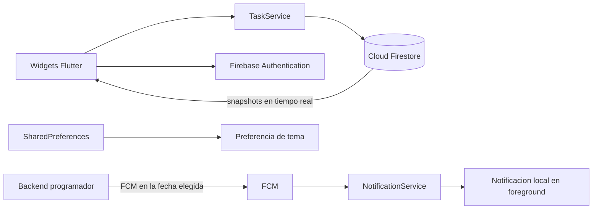

# Informe final: aplicacion movil para gestion de tareas

## 1. Resumen y objetivo

Se propone una aplicacion multiplataforma para organizar actividades personales. Permite crear, consultar, editar, categorizar, completar y eliminar tareas; sincroniza los cambios a traves de Cloud Firestore y conserva una preferencia visual local de tema claro u oscuro. Flutter y Dart permiten compartir la mayor parte de la implementacion entre Android e iOS.

## 2. Arquitectura

La presentacion contiene dashboard, formulario y acceso. `TaskService` encapsula el CRUD y el stream; el modelo `Task` centraliza conversiones Firestore. Firebase Authentication entrega la identidad persistente que define el propietario de los datos. Las reglas de seguridad verifican ese UID en servidor.

## 3. Modelo y base de datos

Ruta: `users/{userId}/tasks/{taskId}`.

| Campo | Tipo Firestore | Uso |
|---|---|---|
| `title` | string | Nombre visible, obligatorio |
| `description` | string | Detalle opcional |
| `category` | string | Personal, Estudio, Trabajo u Otro |
| `dueDate` | timestamp | Fecha de vencimiento y orden de la lista |
| `isCompleted` | boolean | Estado de seguimiento |
| `userId` | string | UID propietario, validado por reglas |

El stream consulta la subcoleccion del usuario ordenada por `dueDate`. Los snapshots de Firestore notifican cambios locales y remotos y el SDK administra cache offline. La estructura por usuario reduce el riesgo de consultas cruzadas; las reglas completas están en `firestore.rules`.

## 4. Integracion y seguridad

Firebase Authentication usa correo y contrasena: varios dispositivos que inician sesion con la misma cuenta reciben el mismo UID y, por tanto, consultan la misma subcoleccion. Las contrasenas son gestionadas por Firebase Authentication y no se guardan en Firestore. Firestore Rules vuelve a validar el UID; ocultar datos en la interfaz no es una medida de autorizacion.

Para desarrollo hay configuracion de emuladores en `firebase.json`. En produccion se deben registrar apps Android/iOS, configurar Firebase por plataforma, exigir contrasenas robustas, revisar reglas antes de publicar y configurar APNs para FCM en iOS. Los secretos de administracion y credenciales de servidor nunca deben incluirse en el cliente.

## 5. Funciones de Flutter aplicadas

- `StreamBuilder` presenta estados de carga, error y datos y redibuja la lista cuando llega un snapshot.
- `ListView.builder` construye bajo demanda y escala mejor que una columna con todas las tareas.
- `Form`, `TextFormField`, `DropdownButtonFormField` y `showDatePicker` capturan y validan datos.
- `FloatingActionButton` inicia el alta; `Card`, `Checkbox` y `PopupMenuButton` permiten inspeccionar, completar, editar y borrar.
- `ThemeData` y `SharedPreferences` implementan tema claro/oscuro con preferencia local persistente.

## 6. Recordatorios y notificaciones

La app solicita permiso de notificaciones, expone el token FCM y convierte mensajes recibidos mientras está en primer plano en notificaciones locales. Para recordar una tarea a futuro, un backend confiable debe programar el envío en `dueDate` (por ejemplo, Cloud Functions junto con Cloud Tasks) y usar el token asociado al UID. Al editar o borrar una tarea se debe actualizar o cancelar el trabajo programado. FCM no garantiza una hora exacta y el comportamiento en segundo plano depende de los permisos y las restricciones del sistema operativo.

Prueba manual propuesta: registrar el dispositivo/token, enviar un mensaje de prueba desde Firebase Console, verificar permiso y recepción en foreground/background en Android y iOS, y confirmar que al tocarlo abre la app. Para una prueba real del recordatorio, crear una tarea cercana y comprobar que el backend la programa y la cancela al borrarla. El emulador de Firestore no prueba entrega APNs/FCM.

## 7. Prototipo de interfaz

El wireframe de baja fidelidad, flujo, dimensiones de referencia, componentes y estados están en `docs/prototipo-ui.md`. Puede trasladarse a Figma o Adobe XD como frames de acceso, dashboard, formulario y confirmación de borrado. La implementación Flutter proporciona una segunda referencia funcional.

## 8. Plan de pruebas y evidencia

`integration_test/firestore_sync_test.dart` abre dos streams de cliente para un mismo UID autenticado contra los emuladores, crea una tarea, marca su estado y la elimina; ambos streams deben observar cada cambio. Esto comprueba la propagación entre suscripciones, pero no sustituye la comprobación manual en dos dispositivos físicos.

Para ejecutarlo:

1. Instalar Firebase CLI y ejecutar `firebase emulators:start --only auth,firestore --project demo-gestor-tareas`.
2. Con el emulador Android/iOS conectado, ejecutar `flutter test integration_test/firestore_sync_test.dart -d <deviceId>`.
3. Guardar la salida de pruebas y capturas de ambos dispositivos como evidencia de la entrega.

Matriz de aceptación adicional: alta/edición/borrado y validación de campos; completar y sincronizar una tarea en dos dispositivos con la misma cuenta; comprobar que dos cuentas no leen los datos entre sí; modo offline/recuperación de conexión; tema persistente; permisos y recepción de notificaciones en Android e iOS.

## 9. Respuestas a las preguntas guía

### 1. Compatibilidad entre Android e iOS

Mantendría la lógica en Dart y separaría las integraciones nativas detrás de servicios. Probaría diferentes tamaños, versiones mínimas y estados de conectividad en emuladores/simuladores y dispositivos; automatizaría análisis y pruebas en CI. Firebase, notificaciones, permisos, APNs y configuraciones de compilación deben verificarse por plataforma, ya que el código compartido no elimina esas diferencias.

### 2. Recordatorios

Solicitaría permisos con explicación contextual y guardaría el token FCM asociado a la cuenta. Un backend confiable programaría el envío para la fecha solicitada, gestionando cambios y cancelaciones. La app presentaría notificaciones con FCM cuando está en background y `flutter_local_notifications` para mensajes en foreground. Probaría permiso denegado, app terminada, ahorro de batería y recepción en ambas plataformas.

### 3. Persistencia y sincronización

Usaría Firestore con `users/{uid}/tasks/{taskId}`, campos tipados y reglas por `request.auth.uid`. Un `snapshots()` por usuario alimenta el dashboard en tiempo real; la persistencia offline del SDK permite tolerar desconexiones. Para asegurar sincronización entre dispositivos se requiere iniciar sesión con una identidad común, no generar una cuenta anónima nueva en cada dispositivo.

### 4. Widgets

`Scaffold`, `AppBar`, `StreamBuilder`, `ListView.builder`, `Card`, `Checkbox` y `FloatingActionButton` forman la pantalla principal. Para captura usaría `Form`, `TextFormField`, `DropdownButtonFormField` y `showDatePicker`; `AlertDialog` pide confirmación de borrado y `SnackBar` comunica errores. Tooltips, contraste y estados vacíos/cargando completan la interacción.

### 5. Usabilidad sin pruebas directas

Aplicaría revisión heurística, recorrido cognitivo de tareas clave, auditoría de accesibilidad/contraste, pruebas automatizadas de formularios y evaluación de prototipo con compañeros. Como retroalimentación indirecta usaría encuestas breves, analítica de embudos con consentimiento, reportes de errores y comentarios de soporte. Estas alternativas detectan problemas probables, pero no reemplazan pruebas moderadas con usuarios representativos.

## 10. Limitaciones y siguientes pasos

La entrega contiene el código Flutter, reglas, configuracion de emuladores, informe y wireframe. Para desplegar y demostrar la app faltan los archivos de Firebase específicos del proyecto, ejecutar la matriz en dispositivos y configurar el backend que programa recordatorios. Las pruebas de emulador deben correrse con Firebase CLI y un dispositivo conectado.

La interfaz reduce carga visual y facilita objetivos táctiles; para el uso responsable se deben mantener contraste y tamaño de texto ajustables, permitir pausas y evitar patrones de notificación invasivos. La sincronización digital reduce el uso de papel; el equipo debe prolongar la vida útil de los dispositivos de prueba y gestionar baterías/equipos electrónicos mediante reciclaje autorizado.